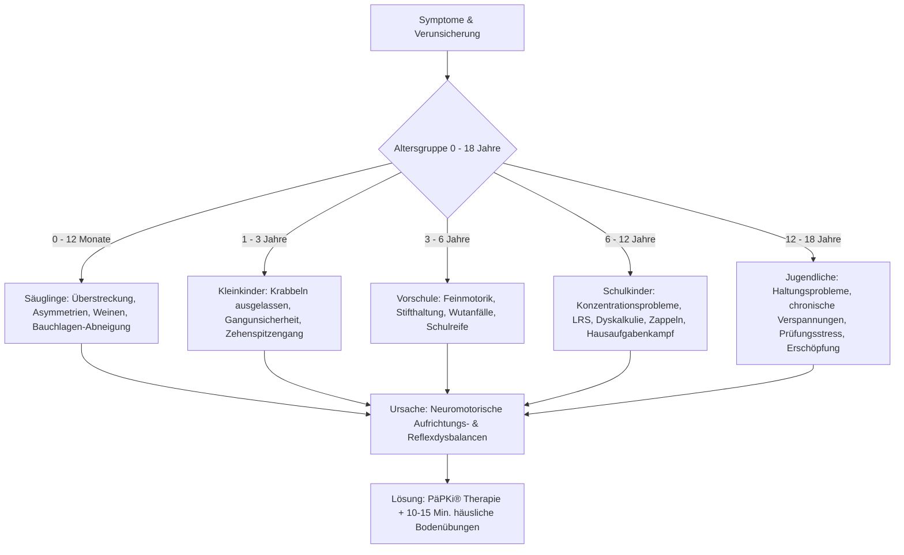

# 💎 Professionelle Verkaufs- & Conversion-Analyse
## Webdesign-Agentur Scholz & Friese | Projekt: *Praxis für Entwicklung*

---

### 1. Executive Summary & Positionierung

| Dimension | Strategische Ausrichtung |
| :--- | :--- |
| **Markenname** | **Praxis für Entwicklung** |
| **Fachrichtung** | Ganzheitliche Entwicklungs- & Lerntherapie nach **PäPKi®** (nach Prof. Dr. phil. Wibke Bein-Wierzbinski) |
| **Altersgruppe** | **0 bis 18 Jahre** (Säuglinge, Kleinkinder, Vorschule, Schulkinder und Jugendliche / Teenager) |
| **Kernversprechen** | *„Die Ursache an der Wurzel packen – statt nur Symptome zu behandeln.“* Wir bringen das Nervensystem und die neuromotorische Aufrichtung vom Säuglingsalter bis zum Jugendalter (0–18 Jahre) in Balance, um Lern-, Haltungs-, Konzentrations- und Entwicklungsblockaden nachhaltig zu lösen. |
| **Primäres Ziel** | Eltern und Jugendliche auf emotionaler & rationaler Ebene abholen, Druck und Schuldgefühle abbauen, Vertrauen stiften und qualifizierte Ersttermine generieren. |

---

### 2. Tiefenpsychologische Problemstellungen & Konkrete Lösungen (0 bis 18 Jahre)

Gerade weil die Altersspanne von 0 bis 18 Jahren reicht, muss die Website klar zwischen den verschiedenen Entwicklungsphasen differenzieren. Jedes Alter hat seine eigenen sensiblen Herausforderungen.



---

#### Detaillierte Problem-Lösungs-Matrix (0 bis 18 Jahre)

| Altersgruppe | Reale Problemstellung & Sorgen | Wie die Praxis für Entwicklung das mit ihren Fähigkeiten löst | Der emotionale & praktische Nutzen |
| :--- | :--- | :--- | :--- |
| **Säuglinge (0–12 Monate)** | • Baby schreit viel, lässt sich schwer beruhigen<br>• Überstreckt sich krampfhaft nach hinten, HASST die Bauchlage<br>• Trink- & Verdauungsprobleme, asymmetrische Kopfhaltung<br>• Eltern fühlen sich überfordert und zweifeln an sich selbst | **Frühkindliche Aufrichtungs-Diagnostik:**<br>• Sanfte Überprüfung der Haltungsreflexe & Wirbelsäulen-Aufrichtung<br>• Erkennen frühkindlicher Blockaden im neuromotorischen Ablauf<br>• Gezielte Handgriffe & Lagerungstechniken für den Alltag | **Sofortige Entlastung:**<br>Das Baby findet in die Entspannung, die Eltern verstehen die Signale ihres Babys und erhalten eine sichere Anleitung für den Alltag. |
| **Kleinkinder (1–3 Jahre)** | • Krabbeln wurde übersprungen (direktes Laufen)<br>• Stolpert ständig, fällt oft hin, wirkt „tollpatschig“<br>• Zehenspitzengang oder krampfhafter Gang<br>• Kinderärzte sagen oft: *„Das wächst sich schon aus“*, doch das Bauchgefühl der Eltern sagt etwas anderes | **Bewegungsbausteine gezielt nachholen:**<br>• Strukturierte Analyse der Muskelketten & des Gleichgewichtssinns<br>• Spielerische Bodenübungen, die das Gehirn und die Muskelkoordination neu vernetzen<br>• Keine Zwangstherapie, sondern natürliches Nachreifen | **Klarheit & Vorbeugung:**<br>Eltern bekommen endlich die Bestätigung ihres Bauchgefühls und beugen späteren Haltungsschäden und Schulproblemen vor. |
| **Vorschule (3–6 Jahre)** | • Stift wird verkrampft gehalten, Malen/Schneiden frustriert<br>• Kann nicht 5 Minuten ruhig sitzen, ständige Wutanfälle<br>• Gleichgewichtsprobleme (Laufrad/Fahrradfahren fällt schwer)<br>• Angst vor dem anstehenden Schulstart | **Vorbereitung auf die Schule (Neuromotorische Schulreife):**<br>• Diagnostik von Restreaktionen frühkindlicher Reflexe<br>• Festigung der Auge-Hand-Koordination & Rumpfstabilität<br>• Gezielte Übungen zur Selbstregulation & Sinnesintegration | **Selbstvertrauen vor dem Schulstart:**<br>Das Kind meistert feinmotorische Aufgaben mit Freude; die Eltern gehen gelassen und zuversichtlich in die Einschulung. |
| **Schulkinder (6–12 Jahre)** | • Schulfrust, täglicher Kampf bei den Hausaufgaben<br>• Konzentrationsprobleme, Diagnose-Verdacht (ADS/ADHS, LRS, Dyskalkulie)<br>• Kind rutscht auf dem Stuhl herum, stützt den Kopf ab<br>• Kind verliert das Selbstwertgefühl („Ich bin dumm“) | **Ursachentherapie statt Nachhilfe-Marathon:**<br>• Aufdecken des Zusammenhangs zwischen mangelnder Aufrichtung und Gehirnermüdung (Kompensation verbraucht alle Energie)<br>• 10–15 Min. tägliches Boden-Nachtraining zu Hause<br>• Reintegration motorischer Reflexe | **Befreiung & Lernerfolg:**<br>Die Konzentrationsfähigkeit steigt spürbar, der Hausaufgabenstreit endet und das Kind gewinnt seinen Stolz und seine Lebensfreude zurück. |
| **Jugendliche & Teenager (12–18 Jahre)** | • Chronische Haltungsschwächen (Rundrücken, Hohlkreuz, Verspannungen durch Smartphone/Schreibtisch)<br>• Konzentrationsabfall bei Prüfungen, Blackouts, Lernblockaden in der weiterführenden Schule<br>• Schnelle Erschöpfung, motorische Unruhe oder Koordinationsschwierigkeiten im Sport<br>• Hoher mentaler Druck & Versagensängste | **Neuromotorische Stabilisierung für Jugendliche:**<br>• Gezieltes Nachreifen tiefer Stützmuskulatur und Aufrichtungsmuster<br>• Entlastung des Nervensystems zur Reduzierung von Stress & Reizüberflutung<br>• Eigenverantwortliche, alltagstaugliche Übungen, die Jugendliche selbstständig umsetzen können | **Starke Haltung & mentale Klarheit:**<br>Gesteigerte Belastbarkeit in Schule und Sport, aufrechte Körperhaltung, spürbare Schmerz- und Stressreduktion. |

---

### 3. Systematischer Trust- & Vertrauens-Aufbau

```
┌─────────────────────────────────────────────────────────────────────────┐
│                      5 SÄULEN DES VERTRAUENS                             │
├─────────────────┬─────────────────┬─────────────────┬───────────────────┤
│ 1. Wissenschaft │ 2. Empathie     │ 3. Keine Schuld │ 4. Befähigung     │
│ & Methode       │ & Wohlfühlraum  │ & Verständnis   │    für zu Hause   │
│ (PäPKi® Fundus) │ (Ohne Kittel)   │ (Aha-Effekt)    │ (10-15 Min. Üben) │
└─────────────────┴─────────────────┴─────────────────┴───────────────────┘
```

1. **Wissenschaftliche Autorität (PäPKi® nach Prof. Dr. Bein-Wierzbinski):**
   * Keine esoterischen Versprechungen, sondern neurophysiologisch fundierte, reproduzierbare Entwicklungslehre von Geburt bis ins Erwachsenwerden.
2. **Entpathologisierung & Schuldabbau („Niemand ist faul oder unbegabt“):**
   * Wenn das neuromotorische Fundament noch nicht stabil aufgerichtet ist, verbraucht der Körper enorm viel Energie, um die Haltung zu kompensieren. Da bleibt kaum Energie für mentale Höchstleistungen.
3. **Praxis als angstfreier Schutz- und Wohlfühlraum:**
   * Eine warme, wertschätzende Praxisatmosphäre ohne klinische Kälte – für Babys, Kinder und Jugendliche auf Augenhöhe.
4. **Hilfe zur Selbsthilfe (10–15 Minuten täglich):**
   * Keine monatelangen, zermürbenden Terminfluten. Ein klarer, machbarer Übungsplan für zu Hause, den Eltern mit kleineren Kindern begleiten oder Jugendliche eigenständig durchführen.
5. **Transparenz & Verlässlichkeit:**
   * Schritt-für-Schritt Ablauf mit klaren Verlaufskontrollen alle 4–6 Wochen, um Fortschritte messbar und spürbar zu machen.

---

### 4. Psychologische Hebel & Copywriting-Prinzipien für die Website

* **Hero-Hook:** *„Wenn der Körper in seine natürliche Balance findet, entfaltet sich das volle Potenzial Ihres Kindes.“*
* **Aha-Moment (Framing):** *„Warum Nachhilfe & Ermahnungen oft ins Leere laufen: Wenn das neuromotorische Fundament wackelt, kann kein Lernstoff halten. Wir stärken das Fundament – von 0 bis 18 Jahren.“*
* **Entlastungs-Versprechen:** *„10 bis 15 Minuten gezielte Bodenübungen am Tag schenken Ihrer ganzen Familie wieder Leichtigkeit, Konzentration und Wohlbefinden.“*
* **Niedrigschwelliger Call-to-Action:** *„Erstgespräch & Anamnese anfragen – Einfühlsam, fundiert und ohne Druck.“*

---

### 5. Seitenarchitektur (UI/UX Pro Max)

1. **Header:** Praxis-Logo, Kern-Navigation (Konzept, Altersstufen 0–18 J., Ablauf, Über mich, FAQ, Kontakt), CTA *„Ersttermin anfragen“*.
2. **Hero Section (UI/UX Pro Max):**
   * *Eyebrow:* Zertifizierte Entwicklungs- & Lerntherapie nach PäPKi® (0–18 Jahre)
   * *Headline:* **„Wir lösen Entwicklungs-, Haltungs- & Schulblockaden an der Wurzel: Im Körper.“**
   * *Subline:* Ganzheitliche Förderung für Babys, Kinder und Jugendliche. Ursachenorientiert, wissenschaftlich fundiert und für spürbare Leichtigkeit im Alltag.
   * *Dual-CTA:* `[ Jetzt Ersttermin anfragen ]` & `[ Altersstufen & Symptome prüfen ↓ ]`
   * *Rechts:* Hochwertige Bildsprache mit Floating-Trust-Badge (*PäPKi® Methode*).
3. **Trust-Leiste (4 Säulen):**
   * 🎓 PäPKi®-zertifiziert
   * 👶 Für Kinder & Jugendliche von 0 bis 18 Jahren
   * 🏠 10–15 Min. Heimtraining
   * 🌿 Ursachenorientiert & Sanft
4. **Das Ursachen-Prinzip (Die PäPKi® Methode):**
   * Wie die neuromotorische Aufrichtung die Basis für Gehirnentwicklung, Stifthaltung, Konzentration und aufrechte Körperhaltung bildet.
5. **Interaktiver Alters-Kompass (5 Altersstufen von 0 bis 18 Jahren):**
   * **5 Tabs:**
     1. *Säuglinge (0–12 Monate)*
     2. *Kleinkinder (1–3 Jahre)*
     3. *Vorschulkinder (3–6 Jahre)*
     4. *Schulkinder (6–12 Jahre)*
     5. *Jugendliche / Teenager (12–18 Jahre)*
6. **Therapie-Ablauf in 4 Schritten:**
   * 1. Erstgespräch & Anamnese → 2. PäPKi® Diagnostik & Reflex-Check → 3. Individueller Übungsplan für zu Hause → 4. Verlaufskontrolle alle 4–6 Wochen.
7. **Über die Praxis & Therapeuten:**
   * Empathische Vorstellung, Qualifikationen, Praxisräume als Wohlfühlort.
8. **Interaktives FAQ:**
   * Antworten zu Ablauf, Zeitaufwand (10–15 Min.), Kosten, Terminen und Begleitung.
9. **Conversion-Formular & Kontakt:**
   * Schnellauswahl der Altersgruppe (0–18 J.), Anliegen-Auswahl, Standort & direkte Kontaktwege.
10. **Footer:**
    * Impressum, Datenschutz, Öffnungszeiten, Standort.
